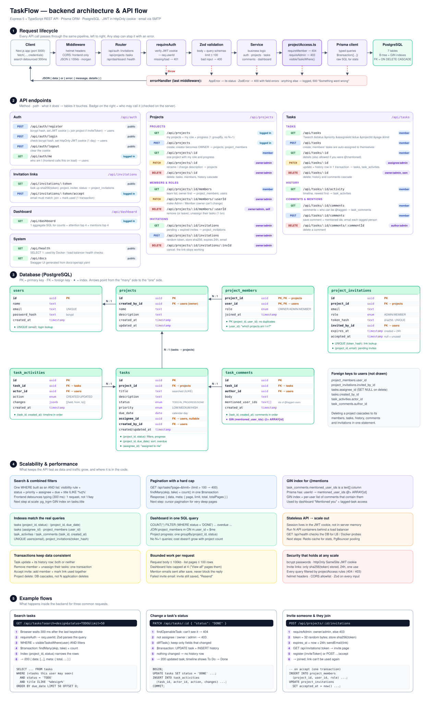
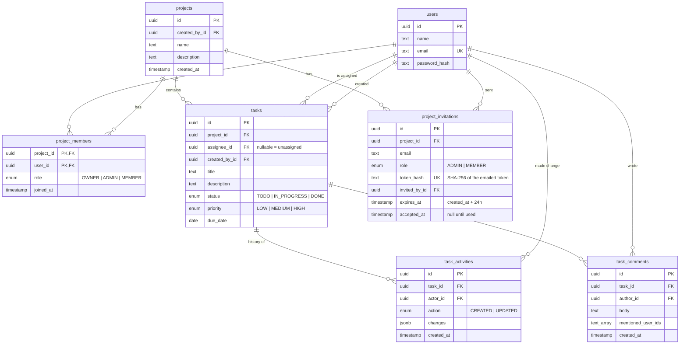

# Architecture


The browser loads the Next.js app. The app calls the Express API with `fetch`, and the httpOnly login cookie goes along automatically. Each request passes through middleware, `requireAuth`, Zod validation and a service. Services ask `projectAccess.ts` what the user may do, then query PostgreSQL through Prisma. Invitations and @mentions go out as emails, and invite links bring people back to `/invite/<token>`.

## Stack

| Layer    | Choice                              | Why                                                                                   |
| -------- | ----------------------------------- | ------------------------------------------------------------------------------------- |
| Frontend | Next.js (App Router), React, Tailwind | Required by the brief; Tailwind keeps the responsive styling quick and consistent      |
| Backend  | Express 5 + TypeScript              | Small and explicit. Express 5 forwards errors from async handlers on its own          |
| Database | PostgreSQL + Prisma                 | Relational data (users ↔ projects ↔ tasks); Prisma gives typed queries and migrations |
| Validation | Zod                               | One schema validates and types each request                                           |
| State    | React Context (auth) + hooks        | The app is small; a global store would add complexity without benefit                |

```
Browser ──► Next.js frontend ──(fetch, cookie)──► Express API ──► PostgreSQL
```

The frontend is a client-rendered app; the browser talks to the API directly using `NEXT_PUBLIC_API_URL`.

## Backend design (detailed diagram)

[](docs/backend-architecture.svg)

The diagram has five parts:
1. **Request lifecycle**: the pipeline every API call goes through.
2. **Endpoints**: who can call each one, and which tables it touches.
3. **Database**: tables, keys and indexes.
4. **Scalability**: search, pagination, the GIN index, the single-query dashboard, transactions.
5. **Example flows**: three requests step by step, with the SQL they run.

## Backend structure

Each feature is a module with three files:

- `*.routes.ts`: HTTP only. Parse and validate the request, call the service, send the response.
- `*.service.ts`: business logic and database queries. No `req`/`res`, so it's easy to test and reuse.
- `*.schemas.ts`: Zod schemas for request bodies and query strings.

Two files hold the rules that matter most:

- [`projects/projectAccess.ts`](backend/src/modules/projects/projectAccess.ts) holds **every permission rule** (who is a member, who is an admin, which tasks a user can see).
- [`tasks/taskHistory.ts`](backend/src/modules/tasks/taskHistory.ts) works out **what changed** in a task update, for the history timeline.

Emails live in `email/`: [`mailer.ts`](backend/src/email/mailer.ts) sends them, and [`templates.ts`](backend/src/email/templates.ts) holds the invitation and mention emails.

Cross-cutting pieces live in `middleware/`: `requireAuth`, plus one global error handler that turns every error into the same JSON shape (`ZodError` → 400 with field details, `AppError` → its status code, anything else → logged and returned as 500).

**Logging:** every request is logged by `morgan` (short and colored in development, the standard Apache "combined" format in production). Unexpected errors are logged with a timestamp, method, URL and user id, but the client only ever sees a generic "Something went wrong".

## Database design



- **`project_members` is a join table** with the role on it, so the same person can be an admin in one project and a member in another. Its primary key is `(project_id, user_id)`, so someone can't be added twice.
- **Roles are per project, not global.** Everyone is equal at the account level; your role only matters inside a project.
- **Tasks keep both `assignee_id` and `created_by_id`.** The assignee does the work and sees the task; the creator is shown on the task page.
- **Comment mentions are a `text[]` column** of user ids, not a separate table. They're only ever read together with their comment, so a join table would add complexity without benefit.
- **Foreign keys:**
  - Deleting a project cascades to its members, tasks and task history.
  - Deleting an assignee sets the task back to unassigned (`ON DELETE SET NULL`).
- **Status, priority, role and action are Postgres enums**, so invalid values are rejected by the database as well as by validation.
- **`due_date` is a `DATE`**, not a timestamp: a due date is a calendar day.
- **Indexes match the real queries:**
  - `project_members(user_id)`: "which projects am I in?", asked on almost every request
  - `tasks(project_id, status)`: status filters and progress counts
  - `tasks(project_id, due_date)`: due-date sorting, overdue and "needs attention"
  - `tasks(assignee_id)`: "tasks assigned to me" and the assignee filter
  - `task_activities(task_id, created_at)` and `task_comments(task_id, created_at)`: one task's timeline and comments, in order
  - `project_invitations(token_hash)` unique: looking up an invite link; `(project_id, email)`: pending invites per project
  - `task_comments(mentioned_user_ids)` **GIN**: "which comments mention me?" (the dashboard's *Mentioned you*). Prisma's `has` filter becomes `mentioned_user_ids @> ARRAY[userId]`. A normal B-tree index can't search inside arrays; a GIN index stores, for each user id, the comments that contain it. With only a few rows Postgres still prefers a full scan; the index pays off as comments grow.

### Migrating existing data

The second migration ([`20261016090000_team_projects_and_task_history`](backend/prisma/migrations/20261016090000_team_projects_and_task_history/migration.sql)) was **hand-edited** so no data is lost. Prisma's generated version would have dropped `projects.user_id` and failed on the new required columns. The hand-edited version:

1. renames `projects.user_id` to `created_by_id`
2. makes every existing project's creator its ADMIN
3. credits existing tasks to their project's creator, then makes `created_by_id` required
4. gives every existing task a "created" history entry

Adding the `OWNER` role took **two** migrations. Postgres can't use a new enum value in the same transaction that adds it, so the first migration only adds `OWNER`, and the second promotes each project's creator to it.

## Authentication

1. **Register/login:** passwords are hashed with bcrypt (10 rounds). Login returns the same "Invalid email or password" whether the email exists or not, so the API doesn't reveal which emails are registered.
2. The server signs a **JWT** (`{ userId }`, 1-day expiry, secret from `JWT_SECRET`) and sends it in a cookie that is:
   - `httpOnly`: page JavaScript can't read it, so an XSS bug can't steal the token
   - `SameSite=Lax`: not sent on cross-site form posts (basic CSRF protection)
   - `Secure` in production
3. **`requireAuth`** middleware verifies the JWT and sets `req.userId`. No database lookup is needed, which keeps the API stateless.
4. **Logout** clears the cookie.

**Trade-off:** a JWT can't be revoked before it expires. If a token were copied before logout, it would stay valid until it expires (at most 1 day). The fix is short-lived access tokens plus refresh tokens stored server-side (an optional item in the brief).

## Authorization (roles)

| Action                                       | Owner | Admin | Member | Not in project |
| -------------------------------------------- | :---: | :---: | :----: | :------------: |
| See the project and its team                 | ✓     | ✓     | ✓      | 404            |
| See every task in the project                | ✓     | ✓     | –      | 404            |
| See tasks assigned to you                    | ✓     | ✓     | ✓      | 404            |
| Change the status of your tasks, comment     | ✓     | ✓     | ✓      | 404            |
| Open a task you were @mentioned on (read + comment only) | ✓ | ✓ | ✓  | 404            |
| Create tasks for yourself; edit/delete them  | ✓     | ✓     | ✓      | 404            |
| Assign tasks to others                       | ✓     | ✓     | 403    | 404            |
| Edit / delete any task                       | ✓     | ✓     | 403    | 404            |
| Edit / delete the project                    | ✓     | ✓     | 403    | 404            |
| Invite people, change roles, remove members  | ✓     | ✓     | 403    | 404            |
| Be removed or demoted                        | never | ✓     | ✓      |                |

**Who allocates work:** assigning work to other people is a lead's job, so only owners/admins can do it. That keeps it clear who decided what. Members can still track their own work:
- A task a member creates is **always assigned to that member**. The API ignores any other assignee, or refuses with 403 if one is given.
- Members can edit and delete the tasks they created.
- On tasks an admin assigned to them, members can only change the status and comment.

**404 vs 403:** to someone outside the project, it simply doesn't exist (404), so the API never reveals that it's there. A member already knows the project exists, so an admin-only action gets an honest 403.

**One rule, used everywhere.** The "which tasks can I see?" rule is a single Prisma `WHERE` builder in [`projectAccess.ts`](backend/src/modules/projects/projectAccess.ts):

```ts
export function visibleTasksWhere(userId: string): Prisma.TaskWhereInput {
  return {
    OR: [
      // Owners and admins see every task in their projects...
      { project: { members: { some: { userId, role: { in: ['OWNER', 'ADMIN'] } } } } },
      // ...members see the tasks assigned to them (only while they're still in the project).
      { assigneeId: userId, project: { members: { some: { userId } } } },
    ],
  };
}
```

Task lists, boards, project progress and the dashboard counts all use it, so the screens can never disagree about who sees what.

**Opening a single task** uses a slightly wider rule, `openableTasksWhere`: the tasks above, **plus tasks where someone @mentioned you in a comment** (while you're still in the project). That lets an admin pull a member into their own task ("@Sam can you check this?"). The member can read it and reply, but:
- **can't change it** (403), since it isn't their task;
- **doesn't see it on their board or in their counts**, so "members see only their tickets" still holds for everything they browse. They reach it from the email or the dashboard's **"Mentioned you"** card.

Access comes from the comment itself (`comments.mentioned_user_ids`), so no extra table is needed. If that comment is deleted, or the person leaves the project, the access goes away. Filters (like `?assigneeId=someone-else`) are added **on top** with `AND`, so a filter can never widen what a member sees.

Other guarantees:

- A task can only be assigned to a member of its project (otherwise 400).
- There is exactly one owner: the creator. `OWNER` can't be given through invitations or role changes, and the owner can't be removed, demoted or leave.
- When someone is removed from a project, their tasks there become unassigned, so the team can pick them up.

## Invitations

```
Owner/admin ──POST /projects/:id/invitations {email, role}──► API
   API: token = 32 random bytes → store SHA-256(token), expires in 24h → email link /invite/<token>
Invitee clicks link ──► /invite/<token> page ──GET /invitations/<token>──► "Alex invited you to Website Redesign"
   no account? → sign-up form (email locked) → POST /auth/register {…, inviteToken} → account + membership
   has account? → sign in → POST /invitations/<token>/accept → membership
   → "Registration successful" popup → project page
```

- **Only a hash of the token is stored.** The token itself exists only in the email. Someone who reads the database still can't use a pending invitation. This is the same idea as storing password hashes.
- **The link works once, for one email, for 24 hours.** Accepting sets `accepted_at`. A different signed-in email gets 403, an expired link 410, a used link 409.
- **Inviting the same email again replaces the old link**, so only the newest email works. Admins can cancel a pending invitation.
- **Registering through a link checks the invitation first**, so a bad link never leaves behind an account that didn't join the project.
- If the email can't be sent, the invitation is still saved and the API says `emailSent: false`; the admin can press "Resend".

## Comments and mentions

- Anyone who can see a task can comment on it. The author or the project's owner/admins can delete a comment.
- **You can @mention anyone in the task's project.** A mention also lets that person open the task to read and comment (see *Authorization*). People outside the project can't be mentioned (400).
- The UI shows a suggestion list when you type `@`. The comment is saved as plain text plus the ids of the people mentioned, and each mentioned person gets an email linking to the task.
- Emails are sent after the comment is saved; a failed email is logged but doesn't fail the comment.

## Email

One `sendEmail()` function with three modes, chosen by configuration:

| Situation             | What happens                                                      |
| --------------------- | ----------------------------------------------------------------- |
| Tests                 | Kept in an in-memory outbox, so tests can read the invite links   |
| `SMTP_HOST` not set   | Printed in the backend terminal (zero-setup local development)    |
| `SMTP_HOST` set       | Sent through that SMTP server (Mailpit locally, any provider in production) |

User-provided text (names, comments) is HTML-escaped before it goes into an email.

## Task history

Every change to a task writes a row to `task_activities`, in the **same transaction** as the update, so a change can never be saved without its history entry (or the other way round).

```json
{ "action": "UPDATED", "actor": "Sam Lee",
  "changes": [{ "field": "status", "from": "TODO", "to": "DONE" },
              { "field": "assignee", "from": null, "to": "Priya Shah" }] }
```

- Only fields that **actually changed** are recorded. Saving the form without changes adds nothing.
- Assignees are stored by **name at the time of the change**, so the timeline still reads correctly even if that person later leaves the project.
- `changes` is `JSONB`: one flexible column instead of a column per field, and new fields can be tracked without a migration.

## Dashboard query

All task statistics come from **one aggregate query**, scoped by the same visibility rule (written in SQL here):

```sql
SELECT
  COUNT(*)                                                     AS "totalTasks",
  COUNT(*) FILTER (WHERE t.status = 'DONE')                    AS "done",
  COUNT(*) FILTER (WHERE t.status <> 'DONE' AND t.due_date < $today) AS "overdue",
  ...
FROM tasks t
JOIN project_members m ON m.project_id = t.project_id AND m.user_id = $userId
WHERE m.role IN ('OWNER', 'ADMIN') OR t.assignee_id = $userId;
```

The `JOIN` keeps only projects the user is in. The `WHERE` then keeps all tasks where they're the owner or an admin, and otherwise only the tasks assigned to them.

- **Overdue** = due before today and not done. A task due *today* isn't overdue yet. "Today" is the UTC date; the frontend uses the same rule.
- **Needs attention** = not done and due within 3 days (including overdue), sorted by due date, then priority. For a member that's their own work; for an owner/admin it includes the whole team's tasks in projects they run. The dashboard shows 4, with "View all" linking to the full filtered list (`/tasks?due=attention`).
- Project progress uses one `GROUP BY project_id, status` query for all projects (no N+1).

## Scalability considerations

1. **Stateless API.** Sessions live in the JWT, not in server memory, so you can run more API containers behind a load balancer without changing code. `GET /api/health` checks the database connection.
2. **Bounded responses.** `GET /api/tasks` is paginated (`page`, `limit`, max 100), and the dashboard's attention list is capped at 4 items.
3. **The database does the heavy work.** Aggregation happens in SQL, list queries avoid N+1, and indexes match the actual `WHERE` / `ORDER BY` clauses.

Next steps if traffic grew: a Redis cache for dashboard numbers, rate limiting on auth routes, a connection pooler (PgBouncer), cursor-based pagination, and a trigram index (`pg_trgm`) for title search. The task history table grows fastest; it could be archived or partitioned by date later.

## Frontend

- **Route groups:** `app/(auth)` holds login/register; `app/(app)` holds the logged-in pages and shares the sidebar layout, which sends logged-out visitors to `/login`. This protects the UI only; the API enforces everything.
- **Pages:**
  - Dashboard
  - Projects
  - Project, with two tabs: **Tasks** and **Members & roles** (invite form, pending invitations, team, permissions table)
  - Tasks board
  - **Task page** (`/tasks/[id]`): details and comments on the left, history timeline on the right
  - **Invite page** (`/invite/[token]`): outside the logged-in layout, because the visitor may not have an account yet
- **Role-aware UI:** the API returns `myRole` on each project. The UI uses it to hide owner/admin-only controls (New task, Edit/Delete, role dropdowns, invite form, the assignee filter). Hiding is only for convenience; the server enforces the same rules.
- **Dashboard links:** stat cards, the status chart and "needs attention" open `/tasks` with filters in the URL (e.g. `/tasks?due=overdue`, `/tasks?status=DONE`). The tasks page reads them as its starting filters.
- **`AuthContext`** loads the current user from `/api/auth/me` and exposes `login`, `register` and `logout`. Any 401 later is treated as "logged out".
- **`useApi(path)`** loads data and returns `{ data, error, loading, reload }`. Passing `null` skips loading (e.g. no project selected yet). While a new request loads, the old data stays on screen.
- **`TasksView`** (filters + search + board) is shared by the Tasks page and each project page. Search is debounced (300 ms).
- Reusable UI pieces in `components/ui`: Button, form fields, Modal, Avatar, Spinner/ErrorMessage/EmptyState, ProgressBar, badges, StatCard.
